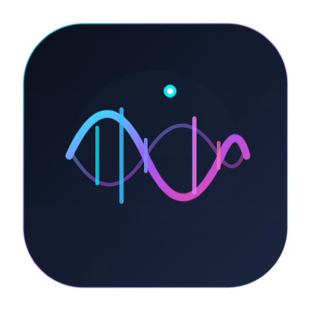

<p align="center">
  
</p>

<h1 align="center">Larynx</h1>

<p align="center">
  <strong>Real-time synchronized lyrics & running musical chords for macOS.</strong><br>
  Ultra-lightweight (<1MB binary, <25MB RAM), native Swift 6, battery-efficient, and leak-free.
</p>

<p align="center">
  
  
  
  
</p>

---

## ✨ Features

* 🎸 **Running Chords Engine**: Real-time musical chord progression display synchronized with lyrics, powered by fuzzy similarity index alignment (`[LyricLine] -> [Chord]`).
* 🔄 **Key Transposition & Capo**: On-the-fly semitone shift ($\pm 12$) and capo position calculation for musicians.
* 🖥️ **Three Presentation Surfaces**:
  * **Menu Bar Ticker**: Marquee active lyric line + running chord progression in your macOS status bar.
  * **MacBook Notch Island**: Sleek floating overlay (`NSPanel` level 25) wrapped around your MacBook camera notch.
  * **Floating Desktop HUD (PiP)**: Draggable, resizable, glassmorphic floating window pinned above active windows.
* 🌐 **Universal Browser Support (Dia, Arc, Chrome, Brave, Safari, Edge)**:
  * Strict running-process guards: **never wakes or launches closed browsers**.
  * Native recognition of **Dia browser** (`company.thebrowser.dia`).
* ⚡ **Zero-Leak Data Governance**:
  * **No Unbounded Logs**: Capped rolling log (<5MB) preventing the 500MB log leaks seen in older apps.
  * **No Memory Bloat**: Stripped out uncompressed 1-second base64 artwork streams.
  * **Smart Timer Suspend**: Timers automatically invalidate when media is paused, display sleeps, or screen locks.

---

## 🆚 Larynx vs. Verse Bar

| Dimension | Verse Bar | Larynx |
| :--- | :--- | :--- |
| **Running Chords** | ❌ None | ✅ Synchronized chord progressions with Key Transpose & Capo |
| **Dia Browser Support** | ❌ None (opens Chrome by mistake) | ✅ First-class native support via `company.thebrowser.dia` |
| **Accidental Browser Launches** | ❌ Triggers `tell application "Google Chrome"` | ✅ Strictly guarded via `NSRunningApplication` |
| **Memory Leak Over 48h** | ❌ Climbs to hundreds of MBs | ✅ Flat memory profile ($\le 25\text{ MB}$ RAM) |
| **Disk Logging Footprint** | ❌ Grew to 514MB `debug.log` on disk | ✅ Hard 5MB rolling cap with automatic rotation |
| **Subprocess Spawning** | ❌ Spawns `/usr/bin/osascript` ~120x/min | ✅ Compiled in-process AppleScript with zero process churn |
| **Binary Size** | 2.5 MB | **696 KB** |

---

## 🚀 Building & Running

### Prerequisites
* macOS 13.0 (Ventura) or later.
* Xcode 15+ / Swift 6.0+ toolchain.

### Build from Source
```bash
# Clone the repository
git clone https://github.com/anggiedimasta/larynx.git
cd larynx

# Run test suite
swift test

# Build optimized release executable
swift build -c release

# Launch Larynx
.build/release/Larynx
```

---

## 📖 In-Depth Technical Documentation

Comprehensive reverse-engineering audits, bug proofs, and product requirements are preserved in [`docs/`](./docs):

* **[`docs/prd-larynx.md`](./docs/prd-larynx.md)** — Complete Product Requirements Document & Data Governance Budgets.
* **[`docs/architecture.md`](./docs/architecture.md)** — Low-level system architecture and Mach-O layout.
* **[`docs/playback-engine.md`](./docs/playback-engine.md)** — Media source detection, verbatim AppleScript scrapers, and bug analyses.
* **[`docs/lyrics-service.md`](./docs/lyrics-service.md)** — LRCLIB REST client, LRC parsing math, and ICU romanization.
* **[`docs/ui-components.md`](./docs/ui-components.md)** — Notch Island math, status item ticker, and Desktop HUD specs.
* **[`docs/settings-and-internals.md`](./docs/settings-and-internals.md)** — UserDefaults schema, hardware media key events, and update checks.

---

## 📄 License

MIT © [Anggie Dimasta](https://github.com/anggiedimasta)
